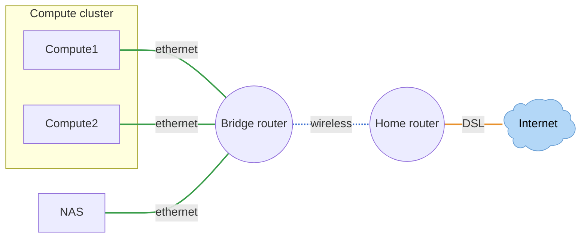

In this article I'll cover the architecture of my homelab. 
To do so, let me first talk about the hardware, so we understand what are the components we are playing with, then talk about the actual architecture and the additional part choices.

# Hardware

I have quite a bit of hardware at home (mostly old one), thanks to my accumulation habit, "One day it might be useful!". I was right, that day has come.

I have (relevant to this project):

| What | Quantity |
| - | - |
| DDR3 SODIMM RAM | 1x 8GB, 4x 4GB |
| 2.5" HDD | 3x 512GB, 1x 128GB |
| SSD | 1x 128GB |
| Laptops | 1x HP EliteBook 745 G3, 2x HP something |
| Boards | 1x Raspberry Pi 4B |

I therefore built the following nodes (every entry is a node):

| Node | Platform | CPU | RAM | ROM |
| - | - | - | - | - |
| Compute1 | HP something | Intel i3-5005U | 12GB (8+4) DDR3 | 128GB SSD |
| Compute2 | HP something | Intel i3-5005U | 8GB (4+4) DDR3 | 128GB SSD |
| NAS | Raspberry Pi 4B | ... | 4GB | 4x512GB HDD|

> **Note**  
> For old components, it is recommendable to test them before using it.
> In my case the components that require testing are: 12GB of RAM of Compute1 and the HDDs of NAS.
> 
> I used [MemTest86](https://www.memtest86.com/) to run the tests on the RAMs (there is an opensource alternative as well, [Memtest86+](https://www.memtest.org/). However, I discovered it afterwards). I haven't tested the disks yet, but that's for the future, the main focus for now is to build the compute cluster. 

# Architecture

- **Home router**
    - Why it exist: It is the preinstalled modem.

- **Bridge router**
    - Model: `Cuby AX3000 2.5GHz PoE (WR3000P)`
    - Why it exist: For practical reasons, I cannot put my homelab setup in proximity of the Home router. Therefore, I thought about using a router as a bridge, that connects to my Home router via wireless (so no cable between them, that's a reuqirement), and connect to my homelab devices via ethernet.