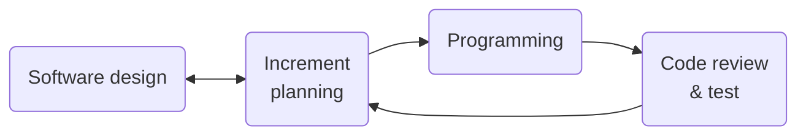

At a certain point, I started (again) to develop a mind mapping software, and (again) I didn't finish it.
That was the firs project in which I accepted/decided to use AI in the development process.
I therefore planned a simple software process, with AI in the loop, and shortly motivated it in the `README.md`, adding my take on AI assisted development.

However, as mentioned before, I dropped the project (and made the repo private), the above mentioned info unavailable.
This blog post solve exactly that problem, reposting them, enjoy :)

# Note on software process
## Approach
### Task division
| Task | How it is carried out |
| - | - |
| System design | Mainly human |
| Programming | Mainly AI |
| Code review | Human |

### Software process

## Reasons
To understand the reasons behind the approach that has been adopted, are worth mentioning the goals I have in mind for this project:
- **Deliver**: Provide to the end user software feature as fast as I can.
- **Quality**: Provide to the end user a software that function correctly/as expected.
- **Efficiency**: Maximize time to result ratio.

Using an [AI-assisted pair programming](#ai-assisted-pair-programming) approach, I can deliver feature faster than I would do without, allowing me to focus more on code reviews and product testing, to guarantee product behavior correctness. On top of that I'm a solo developer and, as of now, a University student, therefore, the time I have to spend behind the development of this software is limited, with this approach I can higher the amount of work done per unit of time. 

# My take on AI assisted development
I would like to start by making a distinction between two activity, that I feel are often confused:

## Vibe coding
I suggest you to read the [Wikipedia article](https://en.wikipedia.org/wiki/Vibe_coding) about it, it give you a good definition about what it is exactly. Anyway, I want to report part of a Tweet, from Karpathy, *"[...] you fully give in to the vibes, [...], and forget that the code even exists. [...] I ask for the dumbest things like "decrease the padding on the sidebar by half" because I'm too lazy to find it. I "Accept All" always, I don't read the diffs anymore. When I get error messages I just copy paste them in with no comment, [...]"* [(Andrej Karpathy, February 3rd 2025, X (ex Twitter) post)](https://x.com/karpathy/status/1886192184808149383). I thinkeit resume really well the concept behind Vibe coding, that appear to be a no-brainer process, where it is not even necessary to understand what AI is doing, and therefore the "developer" don't even know what is actually delivering (in the case the vibe coded software is actually delivered).

## AI-assisted pair programming
[Pair programming](https://en.wikipedia.org/wiki/Pair_programming) is a simple programming paradigm, within which code is written in pairs (pairs of people), one write the code, the other one reviews it at the same time as it is written, the roles are switched following time intervals. With this paradigm there is no one person that wrote the code, both of the parts involved act towards the same goal; both writing and reviewing the code. Now, if one of the sides of the pair is an AI model, then, in my opinion, we are talking about a variation of the original concept of the Pair programming, and we can call it AI-assisted pair programming, that really closely resemble the process that Simon Willison describe as *"If an LLM wrote every line of your code but you've reviewed, tested and understood it all, that's not vibe coding in my book - that's using an LLM as a typing assistant."* [(Simon Willison, March 6th 2025, Simon Willison's Weblog)](https://simonwillison.net/2025/Mar/6/)

# Take home message
I don't want to sound pretentious since I'm a newbie in the field and we can say that I don't have a lot of experience, if not None. Take this, for what it is, a point of view.

I think that as Software engineers (I cover this role in this project, since I do almost everything) part of our job is to make the right choice in accordance with the requirements we have; there is not to much space for gut decisions. So, despite being a person with a bit of a prejudice towards AI-heavy software development, I do think that for this project, AI supported development is a prefect fit, as briefly explained in section [Note on software process/Reasons](#reasons).

AI assisted development don't have to be demonized. Many are the way of integrating AI in the software process, our job is to make it thoughtfully. If all the world is exited about AI, and, what basically AI does is imitating the human brain capability, maybe the human brain is cool. You have one built in, so use it!, don't take everything that AI says at face value, review, criticise, and test it. Give your brain AI as a tool, not as a substitute.
